# Playwright + Python UI Automation Framework

## 1. Framework Overview

This framework automates browser-based user journeys and checks that the application behaves as expected. Tests use readable Gherkin scenarios where useful, Python step definitions, reusable page objects, and Playwright assertions.

| Area | Technology in this repository |
|---|---|
| Language and runner | Python 3.12 in Azure Pipelines; pytest |
| Browser automation | Playwright for Python and pytest-playwright |
| Behaviour scenarios | pytest-bdd and Gherkin feature files |
| Results | Allure, with logs, failure screenshots, and browser videos attached where available |
| CI/CD | Azure Pipelines YAML, using a shared test-step template |

The framework provides reusable browser setup, browser selection, test tagging, cross-browser CI runs, and a common reporting path. This helps teams find regressions earlier and makes failures easier to investigate. Tests should verify user-visible behavior without duplicating application implementation details.

## 2. Architecture

```mermaid
flowchart LR
    CI["Azure DevOps<br/>Pipeline"] --> Runner["pytest<br/>Runner"]
    Runner --> Scenario["BDD Feature<br/>and Scenario"]
    Scenario --> Steps["Python Step<br/>Definitions"]
    Steps --> POM["Page Object<br/>Model"]
    POM --> App["Playwright Browser<br/>and Application"]
    App --> Checks["Playwright Assertions<br/>and Validation"]
    Checks --> Results["Allure Results<br/>Logs · Screenshots · Videos"]
    Results -->|publish report and artifacts| CI
    Runner --> Fixtures["Fixtures<br/>Browser · Context · Page"]
    Fixtures -. injects page .-> Steps
    Utilities["Shared Utilities<br/>Config · Logging · Paths"] -. support .-> POM

    classDef pipeline fill:#DCEBFF,stroke:#2457A6,color:#17365D,stroke-width:2px
    classDef runner fill:#D8F3F0,stroke:#168276,color:#124E48,stroke-width:2px
    classDef scenario fill:#FFF1C9,stroke:#B7791F,color:#633F0B,stroke-width:2px
    classDef steps fill:#FFE2D5,stroke:#C65D32,color:#6E2D18,stroke-width:2px
    classDef pom fill:#FAD9E8,stroke:#AE4778,color:#5B2140,stroke-width:2px
    classDef support fill:#E9E2FF,stroke:#6950A1,color:#34245E,stroke-width:2px
    classDef application fill:#DDF2D9,stroke:#478246,color:#244D28,stroke-width:2px
    classDef validation fill:#FFF0B3,stroke:#A47A00,color:#574000,stroke-width:2px
    classDef reporting fill:#E2E8F0,stroke:#526174,color:#273444,stroke-width:2px

    class CI pipeline
    class Runner runner
    class Scenario scenario
    class Steps steps
    class POM pom
    class Fixtures,Utilities support
    class App application
    class Checks validation
    class Results reporting
```



The pipeline selects the environment and browser, then invokes pytest. Tests use step definitions and page objects to interact with the application. Assertions determine the outcome; Allure results and diagnostic artifacts are published by the pipeline.

## 3. Repository Structure

| Path | Purpose |
|---|---|
| `qa_automation/tests/ui/features/` | Gherkin feature files describing scenarios in plain language. |
| `qa_automation/tests/ui/step_definitions/` | Pytest-BDD scenario bindings and Python functions that implement Given/When/Then steps. |
| `qa_automation/tests/ui/pages/` | Page Object Model classes, including shared `BasePage` behavior and page-specific actions and checks. |
| `qa_automation/tests/ui/config/` | UI test configuration files. `env_url_config.json` is present, but its URL values are currently empty placeholders. |
| `qa_automation/utils/` | Shared helpers for paths, logging, Allure metadata, and report management. |
| `conftest.py` | Shared pytest fixtures and hooks for browser setup, BDD events, logs, screenshots, videos, and Allure metadata. |
| `pytest.ini` | Test discovery paths, feature path, default pytest options, and registered markers. |
| `requirements.txt` | Pinned Python dependencies. |
| `login_setup.py` | Optional script to sign in and save browser storage state for authenticated tests. |
| `auth_state/state.json` | Locally generated browser storage state. Treat it as sensitive; do not commit it. |
| `azure-pipelines.yml` | Pipeline trigger, environment parameter, browser matrix, and failure notification job. |
| `pipelines/templates/ui-test-steps.yml` | Shared CI steps for Python/browser setup, pytest, and Allure publishing. |
| `pipelines/setup-ubuntu-agent.sh` | Installs Python dependencies and Playwright browsers on the Ubuntu agent. |
| `allure-results/` | Raw Allure result files generated by test runs. |
| `test_results/` | Runtime screenshots and recorded browser videos. |
| `reports/latest/`, `reports/archive/` | Locally managed HTML report and archived reports. Azure publishes its pipeline Allure report separately. |

## 4. Test Execution Flow

1. Pytest reads `pytest.ini` to find tests, Gherkin features, markers, and default reporting options.
2. Pytest-BDD connects a scenario in a feature file to its Python scenario binding and step functions.
3. Fixtures in `conftest.py` launch the selected browser and create a fresh browser context and page for the test. If `auth_state/state.json` exists, its storage state is loaded.
4. Step definitions call page object methods to perform user actions or checks.
5. Playwright locators and expectations interact with the browser and verify the resulting UI state.
6. Pytest records the outcome. Logs are attached to Allure; a failed BDD step attempts to capture a screenshot. Browser videos are attached when available.
7. In CI, the shared pipeline template publishes the Allure results and report as pipeline output.

## 5. Page Object Model (POM)

A page object represents a page or reusable UI component. It keeps page-specific locators and operations in one place, so step definitions describe intent instead of low-level browser commands. `BasePage` contains shared browser helpers; page classes such as `HomePage` extend it.

Illustrative, application-neutral example:

```python
from playwright.sync_api import Page, expect

class ExamplePage:
    def __init__(self, page: Page):
        self.page = page
        self.heading = page.get_by_role("heading", name="Example")

    def expect_heading_visible(self):
        expect(self.heading).to_be_visible()
```

Keep assertions close to the behavior they verify, use accessible roles and names when available, and avoid exposing page internals to test steps.

## 6. Fixtures, Configuration, and Test Data

- **Fixtures:** `browser` is session-scoped; `page` creates an isolated context/page for each test and handles video recording. Add shared setup as fixtures when multiple tests need it, and keep test-specific setup narrow.
- **Configuration:** `pytest.ini` controls discovery and markers. Browser selection uses `BROWSER` (`chrome`, `edge`, `firefox`, or `safari`/WebKit); `HEADLESS` controls headed mode. Azure exposes `Dev`, `Test`, and `PreProd` environment choices. Do not assume the placeholder URL mapping is currently read by tests.
- **Authentication:** `login_setup.py` reads `WEBTEST_USERNAME` and `WEBTEST_PASSWORD` (or legacy variable names) and saves browser state. Keep credentials in environment variables or Azure secret variables, never in source control. Protect the generated state file as sensitive data.
- **Test data:** Keep inputs explicit and repeatable. Use fixtures or parameterization for reusable data, and generate unique data only when the test needs it. Faker is listed as a dependency, but its use in the current tests is not established.

Example local commands from the repository root:

```powershell
python -m pytest --collect-only -q
python -m pytest
python -m pytest -m smoke
python -m pytest qa_automation/tests/ui/step_definitions/test_ada_website.py
```

## 7. Reporting and Debugging

- **Allure:** `pytest.ini` writes raw results to `allure-results`. CI publishes the results artifact and generates/publishes an Allure report.
- **Logs:** The `capture_logs` fixture attaches captured test log output to Allure. BDD hooks log scenario and step progress.
- **Screenshots:** A failed BDD step attempts to attach a screenshot to Allure.
- **Videos:** The page fixture records browser video and attaches it after the context closes, when a usable video file is available.
- **Interactive debugging:** Set `HEADLESS=false` to show the browser or `PWDEBUG=1` to use Playwright Inspector. For faster diagnosis, reproduce one test or marker locally before rerunning the full suite.
- **Traces:** Playwright trace recording is not currently configured in the checked-in fixture or pipeline. Add trace capture and artifact retention deliberately if step-by-step network/DOM replay is needed.

## 8. Azure DevOps CI/CD

The root pipeline runs on pushes and has a scheduled weekly run. It accepts `Dev`, `Test`, or `PreProd` as the target environment and uses the `ui-test-secrets` variable group. A browser matrix runs Chrome, Edge, and Firefox jobs, with up to three matrix jobs in parallel. Each current job runs the `smoke` marker with one pytest-xdist worker.

The shared template selects Python 3.12, installs dependencies and Playwright browsers on `ubuntu-latest`, runs pytest, then publishes Allure results and the report. Test execution is configured to continue through publishing so diagnostics remain available. A dependent job attempts email notification when the UI test job fails or reports issues; SMTP settings are optional secret variables in the configured variable group.

To run a different marker, environment, or worker count in CI, update the pipeline parameters/template invocation and make sure the selected tests are safe to run in parallel. Never put credentials directly in YAML or command-line literals.

## 9. Optional Capabilities and Extension Points

These are possible additions, not claims about the current test suite:

| Capability | Current status / practical approach |
|---|---|
| API validation | `requests` is a dependency, but API validation was not identified in the current UI tests. Add API checks when they improve setup, teardown, or independent service coverage. |
| Database validation | No database client or database checks were identified. Add only with approved access and controlled test data. |
| Accessibility | axe-core integration is not currently configured. Add an approved axe integration and include focused accessibility checks in suitable journeys. |
| Parallel execution | pytest-xdist is installed. Local runs can use `python -m pytest -n auto`; CI currently parallelizes browser jobs and uses one worker per job. Isolate test data and avoid shared mutable accounts before increasing workers. |
| Synthetic data | Faker is installed but current use was not identified. Use deterministic seeds or explicit values where reproducibility matters; avoid real personal data. |
| Playwright traces | Not currently enabled. Configure trace capture on failure and publish the trace as a protected artifact if needed. |

## 10. Add a New Test

1. Agree on a user-visible behavior and add a scenario to the relevant `.feature` file under `qa_automation/tests/ui/features/`.
2. Add or reuse a scenario binding and Given/When/Then functions in `qa_automation/tests/ui/step_definitions/`.
3. Put page-specific locators and user actions in an existing page object, or add a focused page object under `qa_automation/tests/ui/pages/`.
4. Use Playwright expectations to verify observable results. Avoid assertions based only on implementation details.
5. Add or reuse a pytest marker in `pytest.ini` when the scenario needs to be selected as a group.
6. Run collection, then the new test locally. Check its Allure attachments and confirm it passes in the intended browser/environment.
7. Keep credentials and generated authentication state out of source control. Update configuration or the pipeline only when the test genuinely needs it.

## 11. Framework Standards

- Prefer stable, user-facing locators such as role, label, and placeholder; avoid brittle positional selectors and unnecessary XPath.
- Do not use fixed sleeps to wait for application behavior. Prefer Playwright auto-waiting, locator state, and web-first expectations.
- Keep scenario steps readable, page objects focused, and shared helpers genuinely reusable.
- Make tests independent: create or reset their own data and do not rely on execution order.
- Use descriptive scenario names and meaningful markers; keep assertions focused on one behavior.
- Store secrets in local environment variables or Azure secret variables. Never log secrets or commit credentials, storage state, or sensitive test data.
- Keep CI artifacts useful but appropriately protected, especially videos, screenshots, traces, and authenticated browser state.
- Increase parallelism only after checking for shared-account, shared-data, and environment contention.
- Treat retries as diagnostic support, not as a substitute for fixing flaky tests.

## 12. Conclusion

The framework combines readable behavior scenarios, reusable Python page objects, isolated Playwright browser contexts, and Allure reporting in an Azure DevOps pipeline. Consistent test boundaries, stable locators, controlled test data, and protected diagnostics allow the suite to grow across browsers and environments while remaining understandable and maintainable.